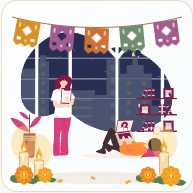

# Inicio: temporadas y dependencias compatibles

La animacion medica conserva los tres Lottie originales y el horario local de Inicio.
Una capa SVG decorativa se selecciona con el reloj existente, sin solicitudes externas.

| Fechas inclusivas, cada ano | Tema |
| --- | --- |
| 20 de octubre a 3 de noviembre | Dia de Muertos |
| 1 de diciembre a 1 de enero | Navidad |
| Resto del ano | Normal |

La actualizacion ocurre cada minuto, incluido el cruce de ano sin recargar Inicio.
Dia de Muertos incorpora papel picado, cempasuchil y veladoras. Navidad incorpora
guirnalda, luces, esferas, arbol y regalos. La iluminacion aumenta por la tarde/noche.
La capa no intercepta interaccion y respeta movimiento reducido. Se conserva la
ocultacion de la animacion en pantallas de hasta 760px.

| Dia de Muertos, noche | Navidad, noche |
| --- | --- |
|  |  |

El lockfile incluye las actualizaciones compatibles pendientes de la revision de
seguridad: follow-redirects 1.16.0 -> 1.16.2 y moment 2.30.1 -> 2.31.0. Sin cambio de
Vue/Vuetify ni nuevas dependencias. No implica resolver todas las deudas legacy.

## Verificacion local, Node 22.22.0

- `node scripts/qa/home-season-browser.cjs`: 18 fechas, 12 renders (dos temporadas,
  tres horarios y 1440/390px), cinco transiciones de medianoche en ambos tamanos,
  movimiento reducido, sin errores de navegador ni overflow. Usa cabecera/componentes
  reales y assets locales, sin autenticacion, API ni DB. Requiere Edge instalado.
- `node scripts/qa/s16-home-session-regression.cjs` y
  `node scripts/qa/owned-home-lottie-regression.cjs`: PASS.
- `node scripts/qa/ux20-scope-visual.cjs`: 12 casos PASS de alcances desktop/movil.
- `node scripts/qa/frontend-issues-regression.cjs`: PASS.
- `node scripts/qa/co21-agenda-regression.cjs`: 14 grupos PASS.
- `node scripts/qa/document-html-security-regression.cjs`: PASS con DOMPurify real.
- `npm run lint -- --no-fix src/views/Home/Home.vue src/views/Home/components/HomeSeasonalDecoration.vue src/utils/homeSeason.js`: PASS.
- `npm run build -- --dest ../_qa/home-christmas-20261026/dist`: PASS, URL API
  sintetica HTTPS solo en el proceso QA; ese artefacto no es para desplegar.
  Persisten avisos de Sass legacy, PulseBackdrop y tamanos.

El script visual genera evidencia en el directorio de documentacion hermano del
repositorio. Los fixtures de sesion y alcances incorporan el nuevo import decorativo.

No requiere migracion o cambios backend. No se modifican secretos ni datos.
La QA aislada no acredita una sesion autenticada o un despliegue. El workflow actual
del frontend no se ejecuta en pull_request; fusionar a main activa su flujo de entrega.

## Reversion

Revertir el commit de temporadas retira las capas y conserva los Lottie originales.
La actualizacion del lockfile vive en un commit separado para poder revertirla sin
alterar el calendario.
